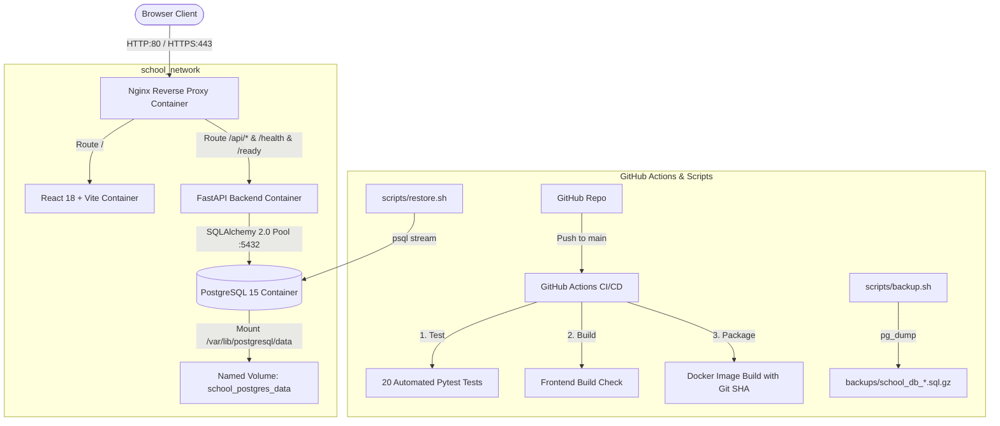
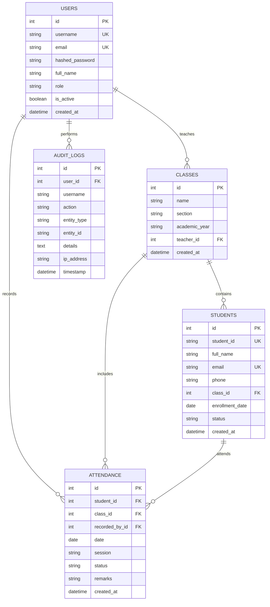

# Cloud Deployment & CI/CD – School Management Platform

**Assessment Submission:** ALGIONS AI LABS PRIVATE LIMITED  
**Candidate Name:** Prince Kumar  
**Registration Number:** 12314718  
**Internship Role:** DevOps & Cloud Engineering  
**Submission Date:** November 2026  

---

## Table of Contents
1. [Project Introduction](#1-project-introduction)
2. [Problem Statement](#2-problem-statement)
3. [Project Objectives](#3-project-objectives)
4. [Technology Stack](#4-technology-stack)
5. [System Architecture](#5-system-architecture)
6. [Architecture Diagram using Mermaid](#6-architecture-diagram-using-mermaid)
7. [Project Folder Structure](#7-project-folder-structure)
8. [Database Design](#8-database-design)
9. [API Documentation](#9-api-documentation)
10. [Local Setup Instructions](#10-local-setup-instructions)
11. [Cloud Deployment: Render (Backend) & Vercel (Frontend)](#11-cloud-deployment-render-backend--vercel-frontend)
12. [Docker Deployment Instructions](#12-docker-deployment-instructions)
13. [Environment Variable Configuration](#13-environment-variable-configuration)
14. [Demo Account Credentials](#14-demo-account-credentials)
15. [CI/CD Workflow Explanation](#15-cicd-workflow-explanation)
16. [Testing Instructions](#16-testing-instructions)
17. [Monitoring and Troubleshooting](#17-monitoring-and-troubleshooting)
18. [Backup and Restore Instructions](#18-backup-and-restore-instructions)
19. [Rollback Instructions](#19-rollback-instructions)
20. [Known Limitations](#20-known-limitations)
21. [Future Improvements](#21-future-improvements)

---

## 1. Project Introduction

The **School Management Platform** is a secure, cloud-native, containerized web application designed for academic institutions to manage synthetic student records, class assignments, and daily attendance tracking. 

Built specifically for the **ALGIONS AI LABS PRIVATE LIMITED** DevOps & Cloud Engineering internship assessment, this project emphasizes:
- Role-based access control (RBAC) with strict authorization boundaries.
- Continuous Integration & Continuous Deployment (CI/CD) with GitHub Actions.
- Production-grade containerization with Docker, Docker Compose, and an Nginx reverse proxy with local HTTPS demonstration.
- Enterprise-grade resilience through automated PostgreSQL backup, restore, and rollback scripts.
- 100% real-time API-driven UI with modern SaaS aesthetics in purple and white.

---

## 2. Problem Statement

Educational institutions face critical operational challenges when deploying attendance management platforms:
1. **Unauthorized Attendance Marking:** Non-teaching staff or unassigned educators recording incorrect attendance records.
2. **Data Duplication:** Accidental double submissions for the same student, date, and session resulting in corrupted statistics.
3. **Deployment Fragility:** Monolithic software with manual deployment steps, lack of health checks, and downtime during updates.
4. **Data Loss Vulnerabilities:** Lack of automated, tested database backup and restoration workflows.
5. **Lack of Automated Testing:** Undetected regressions in authorization and database logic prior to cloud release.

---

## 3. Project Objectives

- **Enforce Business Constraints:** Restrict attendance submission exclusively to assigned class teachers (or administrators); disallow non-teachers (HTTP 403) and unassigned teachers (HTTP 403); prevent duplicate attendance via database constraints (HTTP 409).
- **Deliver Modern SaaS UX:** Develop an intuitive dashboard using React, Tailwind CSS, Lucide icons, and Recharts with toast alerts, modals, and responsive navigation.
- **Implement Robust DevOps Architecture:** Provide containerized services for frontend, backend, PostgreSQL, and Nginx reverse proxy with health checks and volume persistence.
- **Automate Testing & CI/CD:** Establish automated acceptance test suites (Pytest) and a multi-stage GitHub Actions pipeline validating syntax, tests, and Docker images on every push.
- **Ensure Disaster Recovery:** Provide verified backup, restore, and application rollback automation scripts.

---

## 4. Technology Stack

### Frontend:
- **Framework:** React.js 18 with Vite 5
- **Styling:** Tailwind CSS 3 (Deep Purple `#542C83`, Light Purple `#8B5CF6`, Clean White `#FFFFFF`, Background `#F7F7FB`)
- **Routing:** React Router DOM 6
- **HTTP Client:** Axios with JWT bearer interceptors and auto-logout on token expiry
- **Data Visualization:** Recharts (Interactive Area & Bar charts)
- **Icons:** Lucide React

### Backend:
- **Framework:** Python 3.11 + FastAPI
- **ORM & Database Toolkit:** SQLAlchemy 2.0 with connection pooling
- **Validation:** Pydantic v2 schemas
- **Database Engine:** PostgreSQL 15 (with SQLite fallback for isolated unit testing)
- **Migrations:** Alembic version control
- **Authentication:** JWT (JSON Web Tokens) with HS256 algorithm and bcrypt password hashing
- **Testing:** Pytest, pytest-asyncio, and HTTPX

### DevOps & Cloud Infrastructure:
- **Container Engine:** Docker & Docker Compose v2
- **Reverse Proxy:** Nginx 1.25 (HTTP:80 and HTTPS:443 TLS reverse proxy)
- **CI/CD Pipeline:** GitHub Actions with build caching and Git commit SHA image tagging
- **Storage:** Named Docker volumes (`school_postgres_data`) for permanent data persistence
- **Health Probes:** Docker healthchecks + FastAPI `/health` (liveness) & `/ready` (database readiness)
- **Backup & Disaster Recovery:** Bash and PowerShell `pg_dump` backup/restore scripts

---

## 5. System Architecture

The platform follows a 4-tier micro-container architecture:
1. **Reverse Proxy (Nginx):** Ingress controller routing `/` to the React frontend container and `/api/`, `/health`, `/ready`, `/docs` to the FastAPI backend. Terminates SSL/TLS on port 443.
2. **Client Layer (React Single Page App):** Client application served through Nginx with client-side routing fallback.
3. **Application Layer (FastAPI Backend):** RESTful API with stateless JWT authentication, dependency injection, and business rule validation.
4. **Data Layer (PostgreSQL 15):** ACID-compliant relational database with unique constraints, indexes, and automated schema migrations.

---

## 6. Architecture Diagram using Mermaid



---

## 7. Project Folder Structure

```text
Assignment/
├── .github/
│   └── workflows/
│       └── ci.yml                     # 3-Stage GitHub Actions CI/CD Pipeline
├── backend/
│   ├── alembic/
│   │   ├── versions/
│   │   │   └── 001_initial_schema.py   # Initial DB migration
│   │   └── env.py
│   ├── app/
│   │   ├── auth/
│   │   │   ├── dependencies.py        # RBAC & token verification dependencies
│   │   │   └── security.py            # Bcrypt hashing & JWT token generator
│   │   ├── database.py                # SQLAlchemy engine & health probe
│   │   ├── config.py                  # Pydantic v2 application settings
│   │   ├── main.py                    # FastAPI application instance & middlewares
│   │   ├── seed.py                    # Synthetic seed data generator
│   │   ├── models/                    # SQLAlchemy database models
│   │   │   ├── user.py
│   │   │   ├── student.py
│   │   │   ├── class_model.py
│   │   │   ├── attendance.py
│   │   │   └── audit_log.py
│   │   ├── routes/                    # REST API endpoint routers
│   │   │   ├── auth.py
│   │   │   ├── students.py
│   │   │   ├── classes.py
│   │   │   ├── attendance.py
│   │   │   ├── dashboard.py
│   │   │   └── health.py
│   │   ├── schemas/                   # Pydantic validation schemas
│   │   │   ├── auth.py
│   │   │   ├── user.py
│   │   │   ├── student.py
│   │   │   ├── class_schema.py
│   │   │   ├── attendance.py
│   │   │   └── dashboard.py
│   │   └── services/
│   │       ├── attendance_service.py  # Attendance authorization & validation
│   │       └── audit_service.py       # Structured audit logger
│   ├── tests/                         # Pytest test suite (20 tests)
│   │   ├── conftest.py                # In-memory test DB fixture
│   │   ├── test_attendance.py         # Mandatory Acceptance Tests 1-5
│   │   ├── test_auth.py               # Authentication tests
│   │   ├── test_classes.py            # Class CRUD tests
│   │   ├── test_health.py             # Health check tests
│   │   └── test_students.py           # Student CRUD tests
│   ├── alembic.ini
│   ├── Dockerfile                     # Multi-stage non-root Python container
│   ├── entrypoint.sh                  # Migration, seed, and startup script
│   └── requirements.txt
├── frontend/
│   ├── src/
│   │   ├── api/                       # Axios API integrations
│   │   │   ├── auth.js
│   │   │   ├── client.js
│   │   │   ├── students.js
│   │   │   ├── classes.js
│   │   │   ├── attendance.js
│   │   │   ├── dashboard.js
│   │   │   └── health.js
│   │   ├── components/                # Reusable UI components
│   │   │   ├── cards/                 # StatCard, ChartCard
│   │   │   ├── common/                # Modal, ConfirmDialog, Pagination, Spinner
│   │   │   └── layout/                # Sidebar, Topbar, DashboardLayout
│   │   ├── context/                   # AuthContext, ToastContext
│   │   ├── pages/                     # Application views
│   │   │   ├── Attendance.jsx
│   │   │   ├── Classes.jsx
│   │   │   ├── Login.jsx
│   │   │   ├── Overview.jsx
│   │   │   ├── Reports.jsx
│   │   │   ├── Settings.jsx
│   │   │   └── SystemHealth.jsx
│   │   ├── App.jsx
│   │   ├── index.css
│   │   └── main.jsx
│   ├── Dockerfile                     # Node 20 builder + Nginx Alpine runner
│   ├── nginx.conf                     # Internal SPA fallback configuration
│   ├── package.json
│   ├── tailwind.config.js
│   └── vite.config.js
├── nginx/
│   ├── conf.d/
│   │   └── default.conf               # Reverse proxy routing & HTTPS config
│   ├── ssl/
│   │   ├── generate-cert.sh           # Local self-signed certificate generator
│   │   └── generate-cert.ps1
│   └── Dockerfile
├── scripts/
│   ├── backup.sh                      # PostgreSQL pg_dump automated backup
│   ├── restore.sh                     # PostgreSQL interactive restore
│   ├── rollback.sh                    # Application Git rollback & health check
│   ├── backup.ps1                     # Windows PowerShell backup script
│   ├── restore.ps1                    # Windows PowerShell restore script
│   └── rollback.ps1                   # Windows PowerShell rollback script
├── docs/
│   ├── architecture.md                # In-depth architectural documentation
│   ├── deployment.md                  # Deployment procedures
│   ├── backup-restore.md              # Disaster recovery runbook
│   ├── testing.md                     # Pytest testing guide
│   ├── troubleshooting.md             # Fault remediation runbook
│   ├── runbook.md                     # Operational procedures
│   └── evidence-checklist.md          # Reviewer evidence capture checklist
├── docker-compose.yml                 # Multi-service composition file
├── .env.example                       # Environment configuration template
├── .gitignore
└── README.md
```

---

## 8. Database Design

The database schema is managed via **Alembic** migrations and PostgreSQL constraints:



### Critical Constraints:
1. **Duplicate Prevention:** `UniqueConstraint("student_id", "date", "session", name="uq_student_date_session")` guarantees that no student can have multiple attendance records on the same calendar day for the same session.
2. **Student ID Uniqueness:** `UNIQUE` index on `students(student_id)`.
3. **Foreign Key Integrity:** Cascading deletes on student deletion to clean up attendance records; `SET NULL` on user deletion to preserve class and audit history.

---

## 9. API Documentation

| Method | Endpoint | Description | Role Required |
|---|---|---|---|
| **POST** | `/api/auth/login` | Authenticate with username/email & password; returns JWT token | Public |
| **GET** | `/api/auth/me` | Fetch active profile of authenticated user | Authenticated |
| **GET** | `/api/students` | List paginated students with search and class filtering | Authenticated |
| **POST** | `/api/students` | Enroll a new synthetic student | Teacher / Admin |
| **GET** | `/api/students/{id}` | Retrieve individual student record | Authenticated |
| **PUT** | `/api/students/{id}` | Update student details | Teacher / Admin |
| **DELETE** | `/api/students/{id}` | Delete student record | Admin only |
| **GET** | `/api/classes` | List all academic classes with student counts | Authenticated |
| **POST** | `/api/classes` | Create a new class section | Admin only |
| **GET** | `/api/classes/{id}` | Retrieve specific class details | Authenticated |
| **PUT** | `/api/classes/{id}` | Update class or teacher assignment | Admin only |
| **DELETE** | `/api/classes/{id}` | Delete class section | Admin only |
| **GET** | `/api/attendance` | Filter attendance records by class, date, or student | Authenticated |
| **POST** | `/api/attendance` | Record attendance (bulk or single) with RBAC checks | Assigned Teacher / Admin |
| **GET** | `/api/attendance/report` | Aggregated attendance report with percentages | Authenticated |
| **GET** | `/api/dashboard/stats` | Live institutional KPI statistics | Authenticated |
| **GET** | `/api/dashboard/attendance-chart` | 7-day attendance trend data | Authenticated |
| **GET** | `/api/dashboard/recent-activity` | Structured audit trail entries | Authenticated |
| **GET** | `/health` | Application liveness probe | Public |
| **GET** | `/ready` | Database readiness & process memory probe | Public |

*Interactive Swagger documentation is available at `/docs` when the server is running.*

---

## 10. Local Setup Instructions

The application can be run locally without requiring Docker or a running PostgreSQL server. If PostgreSQL is not detected, the backend automatically falls back to an embedded SQLite database (`school.db`) pre-seeded with all demo accounts and records.

### Prerequisites:
- Python 3.11+
- Node.js 18+ & npm

---

### Step 1: Start the FastAPI Backend

#### Windows (PowerShell):
```powershell
# 1. Create and activate virtual environment (if not already created)
python -m venv backend\venv
.\backend\venv\Scripts\Activate.ps1

# 2. Install dependencies
pip install -r backend\requirements.txt

# 3. (Optional) Seed database with demo accounts (idempotent)
python -m app.seed

# 4. Launch backend development server on port 8000
python -m uvicorn app.main:app --app-dir backend --reload --host 127.0.0.1 --port 8000
```

#### Linux / macOS (Bash):
```bash
# 1. Create and activate virtual environment
python3 -m venv backend/venv
source backend/venv/bin/activate

# 2. Install dependencies
pip install -r backend/requirements.txt

# 3. (Optional) Seed database with demo accounts
PYTHONPATH=backend python -m app.seed

# 4. Launch backend development server
uvicorn app.main:app --app-dir backend --reload --host 127.0.0.1 --port 8000
```

* Backend Swagger API Documentation: [http://127.0.0.1:8000/docs](http://127.0.0.1:8000/docs)
* Health Check: [http://127.0.0.1:8000/health](http://127.0.0.1:8000/health)

---

### Step 2: Start the React Frontend

Open a new terminal window:

```bash
# 1. Enter the frontend directory
cd frontend

# 2. Install npm dependencies
npm install

# 3. Launch Vite development server
npm run dev
```

* Frontend UI: [http://localhost:5173](http://localhost:5173)

The Vite development server is pre-configured to automatically proxy `/api`, `/health`, and `/ready` requests to the FastAPI backend at `http://127.0.0.1:8000`.

---

## 11. Cloud Deployment: Render (Backend) & Vercel (Frontend)

For full step-by-step production instructions on deploying this project with **FastAPI + PostgreSQL on Render** and **React SPA on Vercel**, see the dedicated guide:

👉 **[DEPLOYMENT_RENDER_VERCEL.md](DEPLOYMENT_RENDER_VERCEL.md)**

### Key Highlights of Cloud Configuration:
- **CORS Handling:** The backend dynamically allows Vercel subdomains via `CORS_ORIGIN_REGEX=r"^https:\/\/.*\.vercel\.app$"` and custom origins via `CORS_ORIGINS`.
- **Database Normalization:** Automatically adapts Render's `postgres://` connection string to SQLAlchemy's required `postgresql+psycopg2://` driver format.
- **Client-Side Routing:** Contains `vercel.json` rewrites to guarantee React Router routes (`/dashboard`, `/attendance`, `/classes`) do not return 404 errors on page reload.
- **1-Click Render Blueprint:** Includes `render.yaml` for instant infrastructure-as-code provisioning on Render.

---

## 12. Docker Deployment Instructions

To spin up the entire 4-tier infrastructure with a single command:

```bash
docker compose up --build -d
```

### Check Container Status:
```bash
docker compose ps
```

All 4 services will report `healthy`:
- `school_postgres`
- `school_backend`
- `school_frontend`
- `school_nginx`

Access the web application at **[http://localhost](http://localhost)** or **[https://localhost](https://localhost)**.

---

## 13. Environment Variable Configuration

Copy `.env.example` to `.env`:
```bash
cp .env.example .env
```

| Variable | Description | Default |
|---|---|---|
| `POSTGRES_USER` | PostgreSQL superuser username | `postgres` |
| `POSTGRES_PASSWORD` | PostgreSQL database password | `postgres` |
| `POSTGRES_DB` | PostgreSQL database name | `school_db` |
| `DATABASE_URL` | SQLAlchemy connection string | `sqlite:///./school.db` (local fallback) |
| `SECRET_KEY` | Secret key for signing JWT tokens | `algions-devops-secret-key-super-secure-2026-production` |
| `ACCESS_TOKEN_EXPIRE_MINUTES` | JWT token validity window | `1440` (24 hours) |
| `ENVIRONMENT` | Deployment environment mode | `production` |
| `LOG_LEVEL` | Application logging verbosity | `INFO` |

---

## 14. Demo Account Credentials

For technical evaluation, four pre-configured synthetic accounts are seeded into the database:

| Role | Name | Email / Username | Password | Assigned Class | Permissions & Scope |
|---|---|---|---|---|---|
| **Administrator** | Prince Kumar | `admin@algions.edu` | `Admin@123` | All Classes | Full system control: create/delete students, create classes, record attendance, access audit logs. |
| **Teacher A** | Dr. Vikram Malhotra | `teacher.a@algions.edu` | `Teacher@123` | **Class 10 - A** | Authorized to mark attendance **only** for Class 10-A. Blocked from Class 10-B. |
| **Teacher B** | Prof. Ananya Sen | `teacher.b@algions.edu` | `Teacher@123` | **Class 10 - B** | Authorized to mark attendance **only** for Class 10-B. Blocked from Class 10-A. |
| **Staff / Viewer** | Rohan Verma | `staff@algions.edu` | `Staff@123` | None | Read-only non-teacher. Attendance recording returns **HTTP 403 Forbidden**. |

> **Pro-Tip for Reviewers:** Use the **1-Click Quick Role Switcher** on the Login page or in the Top Navigation bar to instantly switch between accounts during testing.

---

## 15. CI/CD Workflow Explanation

The repository includes a production-grade GitHub Actions pipeline at `.github/workflows/ci.yml`.

### Pipeline Triggers:
- Push to the `main` branch.
- Pull Requests targeting the `main` branch.

### Pipeline Stages:
1. **Backend Testing & Code Quality:**
   - Checks out code with `actions/checkout@v4`.
   - Sets up Python 3.11 with pip caching.
   - Installs dependencies from `requirements.txt`.
   - Executes `flake8` for syntax errors and complexity verification.
   - Executes all 20 Pytest acceptance and unit tests against an isolated in-memory test database.
2. **Frontend Build & Asset Compilation:**
   - Sets up Node.js 20 with npm caching.
   - Executes `npm ci` for deterministic clean installs.
   - Executes `npm run build` to verify clean JSX/Vite compilation.
3. **Container Build & Tagging Strategy:**
   - Validates `docker compose config`.
   - Builds Backend and Frontend Docker images with multi-stage caching.
   - Tags Docker images using the exact **Git commit SHA** (`${{ github.sha }}`) and `latest` tag for immutable release traceability.

---

## 16. Testing Instructions

Execute the automated test suite locally:

```bash
# Windows
backend\venv\Scripts\pytest backend\tests -v -W ignore::DeprecationWarning

# Linux / macOS
pytest backend/tests -v -W ignore::DeprecationWarning
```

### Verified Acceptance Tests:
1. `test_1_non_teacher_cannot_record_attendance`: Verifies non-teacher gets **HTTP 403 Forbidden**.
2. `test_2_unassigned_teacher_cannot_record_attendance`: Verifies unassigned teacher gets **HTTP 403 Forbidden**.
3. `test_3_authorized_teacher_can_record_attendance`: Verifies assigned teacher receives **HTTP 201 Created**.
4. `test_4_student_not_in_class_rejected`: Verifies non-enrolled student attendance gets **HTTP 400 Bad Request**.
5. `test_5_duplicate_attendance_rejected`: Verifies duplicate attendance on same date/session gets **HTTP 409 Conflict**.

**Test Result:** `20 passed, 0 failures` (100% pass rate).

---

## 17. Monitoring and Troubleshooting

- **Liveness Probe:** `GET /health` returns application uptime, service name, and version.
- **Readiness Probe:** `GET /ready` returns active PostgreSQL connection status (`healthy: true`), memory usage (RSS MB), and process PID.
- **Structured Logging:** Emits JSON-compatible logs tracking method, path, HTTP status, client IP, and latency in milliseconds.
- **Audit Logging:** Emits `[AUDIT]` logs for attendance submissions, student enrollments, deletions, and class updates.

### Troubleshooting Guide:
Refer to [`docs/troubleshooting.md`](docs/troubleshooting.md) for step-by-step remediation of:
- Port 80/443 conflicts.
- PostgreSQL connection timeouts.
- Alembic migration version mismatch.
- Nginx 502 Bad Gateway upstream errors.

---

## 18. Backup and Restore Instructions

### To Run a Database Backup:
```bash
# Linux/macOS
./scripts/backup.sh

# Windows
.\scripts\backup.ps1
```
Creates a compressed snapshot: `backups/school_db_backup_YYYYMMDD_HHMMSS.sql.gz`.

### To Restore a Database Backup:
```bash
# Linux/macOS
./scripts/restore.sh

# Windows
.\scripts\restore.ps1
```
Asks for interactive user confirmation to avoid accidental overwriting, streams the SQL dump to the database container, and runs a student record count verification.

---

## 19. Rollback Instructions

When an issue occurs following a deployment:

```bash
# Linux/macOS
./scripts/rollback.sh <target-commit-or-tag>

# Windows
.\scripts\rollback.ps1 -TargetVersion "<target-commit-or-tag>"
```

The script stashes dirty working tree changes, checks out the previous stable Git commit, triggers `docker compose up --build -d`, and queries the `/health` endpoint to verify recovery.

---

## 20. Known Limitations

1. **Self-Signed SSL Certificates:** The local HTTPS certificate is self-signed for demonstration. In a public cloud deployment, a trusted Certificate Authority (e.g. Let's Encrypt with Certbot or AWS Certificate Manager) should be utilized.
2. **Synchronous Single-Host Backups:** The backup script stores snapshots on the host filesystem. In cloud production, backups should be replicated to object storage (e.g., AWS S3 or Google Cloud Storage) with lifecycle retention policies.
3. **Session Revocation:** JWT tokens are stateless. A Redis-backed token denylist could be added for instantaneous token revocation prior to expiration.

---

## 21. Future Improvements

1. **Kubernetes (K8s) Helm Charts:** Package the platform as a Helm chart with Horizontal Pod Autoscaling (HPA) and cert-manager ingress.
2. **Prometheus & Grafana Telemetry:** Expose `/metrics` endpoint with Prometheus metrics (request count, p99 latency, error rates) and a Grafana dashboard.
3. **Automated Cloud Backup Replication:** Integrate AWS S3 / GCP Cloud Storage synchronization in `backup.sh`.
4. **Biometric / RFID Attendance Integration:** Provide a webhook API endpoint for physical biometric scanners and RFID card readers.
5. **Parent Notification SMS / Email:** Automated SMS notifications via Twilio or AWS SNS when a student is marked Absent.

---

### Candidate Verification Note
This project was designed, implemented, containerized, and documented by **Prince Kumar** (Registration Number: **12314718**) for the **ALGIONS AI LABS PRIVATE LIMITED** DevOps & Cloud Engineering internship assessment. All student data and credentials provided in this repository are strictly synthetic.

