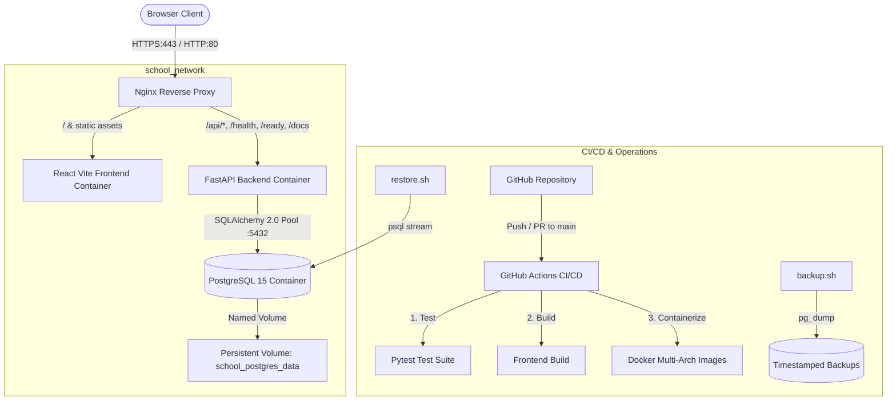
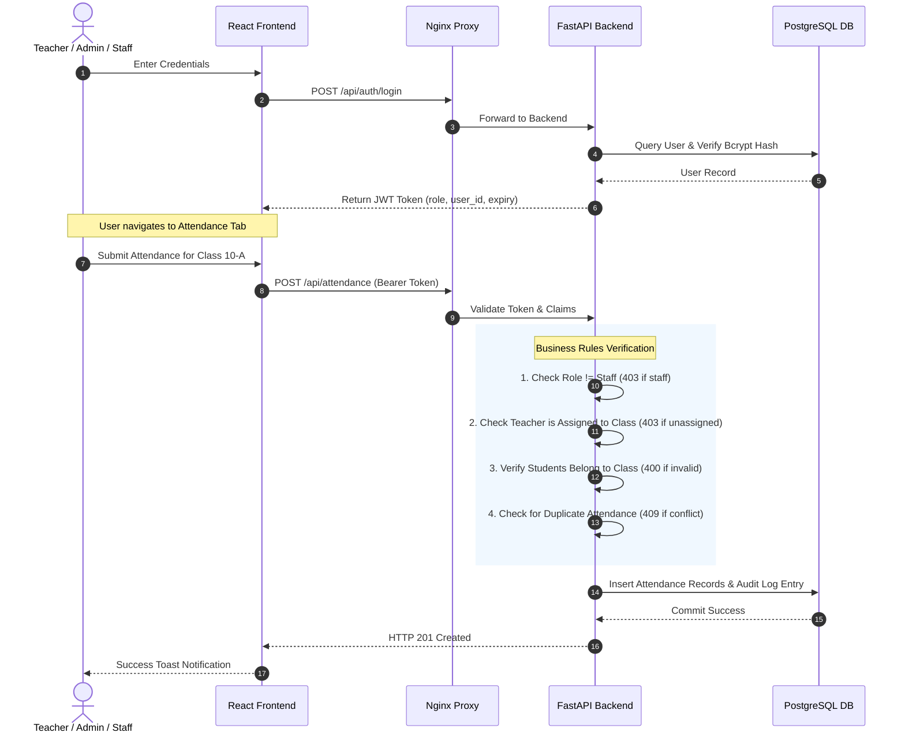

# System Architecture Document

**Project:** Cloud Deployment & CI/CD – School Management Platform  
**Candidate:** Prince Kumar  
**Registration Number:** 12314718  
**Company:** ALGIONS AI LABS PRIVATE LIMITED  
**Role:** DevOps & Cloud Engineering  

---

## 1. High-Level Architecture Overview

The platform uses a secure, containerized micro-tier architecture composed of:
1. **Nginx Reverse Proxy**: Single entry point handling TLS termination (HTTPS:443), HTTP:80, reverse proxy routing, rate limiting, and HTTP security headers.
2. **React SPA Frontend**: Vite-bundled Single Page Application with Tailwind CSS, React Router DOM, and Recharts, served via Nginx with client-side route fallback.
3. **FastAPI Backend**: Asynchronous REST API providing business logic, JWT authentication, role-based access control (RBAC), Pydantic v2 data validation, and structured logging.
4. **PostgreSQL 15 Database**: Relational storage engine with ACID compliance, relational integrity constraints (foreign keys and unique constraints), and Alembic schema migrations.

---

## 2. Security Architecture & RBAC Flow

---

## 3. Network Topology & Container Isolation

- **External Interface:** Port `80` (HTTP) and Port `443` (HTTPS with TLS) exposed on Nginx.
- **Internal Network:** Isolated Docker bridge network named `school_network`. The database (port 5432) and backend (port 8000) are intentionally **NOT** exposed directly to the public internet. All traffic must ingress through the Nginx reverse proxy.
- **Persistent Storage:** Docker named volume `school_postgres_data` mapped to `/var/lib/postgresql/data` ensuring synthetic student and attendance records persist across container restarts and host reboots.

